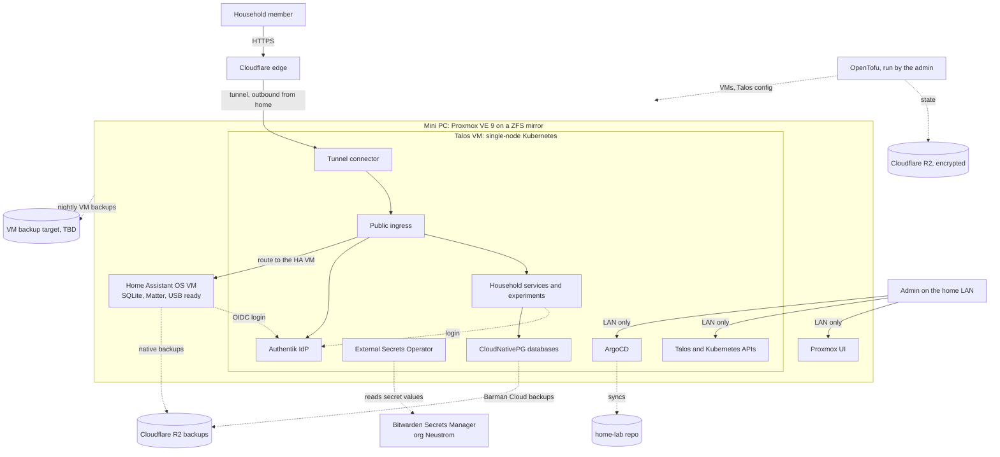

# Home lab context

What this lab is for, who it serves, where it is going, and how far agents may act on their own. Read this before
planning any change that adds a service, touches access or secrets, or moves work toward the new host. Terms in
_italics_ are defined in [GLOSSARY.md](GLOSSARY.md). The reasoning behind each architectural choice lives in
[docs/adr/](docs/adr/), and this file links to it rather than repeating it.

## Intent

The lab runs _household services_ that make everyday life easier for one household, for example a recipe database or
a baby sleep tracker. It is also where Robert tries new things to see if they fit, as _experiments_.

When the two compete, household services win. They get the uptime and backup guarantees. An experiment runs in its
own app and namespace, has no backup promise, and can be removed without affecting a household service.

Several planned services hold personal data. Every _public app_ therefore has an _IdP gate_, with no exceptions for
experiments.

The repo is public and part of Robert's portfolio. It stays safe to publish: no secret values, and no network details
beyond what the repo already shows.

## Users

- Robert is the only _admin_. He administers the lab from the home LAN.
- His wife is a _household member_. She reaches services from her own devices with no VPN client and no custom DNS
  settings.
- Relatives and Robert's daughter may become household members later. Onboarding a new household member means
  creating an IdP account and nothing else.

## Target architecture

- The host is an x86-64 mini PC with two disks in a ZFS mirror, running Proxmox VE 9. Robert installs the host by
  hand once from a documented checklist. See [ADR 0003](docs/adr/0003-proxmox-host-talos-vm-separate-ha-vm.md).
- The cluster is a single Talos node in one VM. Home Assistant OS runs in its own VM with its own SQLite recorder, so it
  keeps working when the cluster is down. It is configured in its UI and managed by backups, not GitOps. The cluster
  ingress routes to it, so Home Assistant has no ingress of its own. Details are in
  [ADR 0003](docs/adr/0003-proxmox-host-talos-vm-separate-ha-vm.md) and
  [docs/research/home-assistant.md](docs/research/home-assistant.md).
- OpenTofu declares the VMs and the Talos machine config. Its state is encrypted in Cloudflare R2. ArgoCD syncs
  everything inside the cluster from git. Pulumi is retired. See
  [ADR 0004](docs/adr/0004-opentofu-for-infrastructure-replacing-pulumi-argocd-for-apps.md).
- App databases run on CloudNativePG in the cluster, declared as manifests and backed up to Cloudflare R2. See
  [ADR 0007](docs/adr/0007-cloudnativepg-in-cluster-replacing-host-postgres.md).
- Persistent volumes are local-path volumes on a dedicated VM disk that sits on the ZFS mirror. See
  [ADR 0005](docs/adr/0005-local-path-on-zfs-instead-of-longhorn.md).
- Household members come in through a Cloudflare Tunnel, and Authentik is the IdP for every public app. The admin
  works from the home LAN. See [ADR 0001](docs/adr/0001-tunnel-and-authentik-for-household-admin-lan-only.md).
- Secret values live in Bitwarden Secrets Manager and External Secrets Operator pulls them into the cluster. See
  [ADR 0002](docs/adr/0002-external-secrets-with-bitwarden-instead-of-sealed-secrets.md).
- The mirror protects against a failed disk only. CloudNativePG and Home Assistant back up to Cloudflare R2, and
  Proxmox backs up the VMs nightly. The VM backup target and the backup tool for other volumes are still open.

## Exposure rules

- Any app with an ingress is a public app, reachable through the tunnel. Its IdP gate is either Authentik forward-auth
  at the proxy or the app's own OIDC login against Authentik, marked with an explicit annotation that CI accepts.
- An _admin surface_ is _LAN-only_. It never gets a public ingress or a tunnel route, even behind the IdP. Admin
  surfaces are the Proxmox UI, the Talos API, the Kubernetes API, ArgoCD, the Authentik admin interface and the Traefik
  dashboard.
- Home Assistant is a public app with app-native OIDC through `hass-oidc-auth`, and nothing in front of it at the
  proxy. The mobile app logs in with a device code that the user confirms in a browser.
- The target has no Tailscale.

## Agent autonomy

The _infra bot_ owns GitHub Issues and pull requests on this repo and works through them with Robert. See
[ADR 0006](docs/adr/0006-agents-open-prs-robert-merges.md).

Agents may do these on their own:

- Open branches and pull requests for `owner:agent` issues that are not `blocked`.
- Write manifests, OpenTofu code and docs, including `ExternalSecret` manifests that name a secret.
- Create, label and link issues, keep the GitHub Project board current, and post the _weekly digest_.
- Run read-only checks against the repo and the cluster.

These stay behind a _human gate_, meaning Robert does them or approves each one:

- Merging to `main`.
- Running `tofu apply`.
- Creating, reading or rotating a secret value.
- Deleting data, including volumes, databases and backups.
- Changing the Proxmox host.
- Anything that needs money or hardware, such as buying the mini PC.

Later, once Robert trusts the review quality, agents may merge low-risk changes such as image bumps that pass CI and
verification. That step needs a new ADR that supersedes ADR 0006.

## Work tracking

- Issues are the shared work queue. Every open issue is either an _owner:human issue_ or an _owner:agent issue_.
- `blocked` marks an issue waiting on another one, and the dependency is a "blocked by" link to that issue.
- `needs-decision` marks an issue that waits on a choice only Robert can make.
- The infra bot posts a weekly digest of owner:human issues that block other work. It pings Robert when one of them
  blocks a pull request that is otherwise ready.

## Current state vs target

The current lab is the starting point for a fresh build, not something to migrate in place. Facts below come from the
repo at `b8b4b3f` and the review from 2026-10-11.

| Area | Today | Target |
| --- | --- | --- |
| Hardware | Raspberry Pi 5, one disk | x86-64 mini PC, two disks in a ZFS mirror (not bought yet) |
| Host OS | DietPi, configured by `diet-pi/` and one Ansible playbook | Proxmox VE 9, hand-installed from a checklist |
| Cluster | k3s on the host | Talos in a VM, managed through `talosctl` |
| Home Assistant | Not running | Home Assistant OS VM, fresh start, routed through the cluster ingress |
| App databases | PostgreSQL 17 on the host, Ansible config, Pulumi roles | CloudNativePG in the cluster |
| Infrastructure code | Pulumi with local state, for Postgres roles | OpenTofu for VMs and Talos config |
| Infrastructure state | `~/.pulumi/` on one laptop | Cloudflare R2, encrypted with a key in Bitwarden |
| Apps | ArgoCD, with its root apps applied by hand | ArgoCD, with nothing applied by hand except bootstrap |
| Secrets | Sealed Secrets, key bound to the cluster, no backup | ESO with Bitwarden Secrets Manager |
| Household access | Tailscale, wildcard DNS to the tailnet IP | Cloudflare Tunnel |
| Admin access | Tailscale or LAN | LAN only |
| Auth | Authentik disabled since `5e9631d`, Tailscale is the gate | Authentik in front of every public app |
| Storage | local-path on the Pi's disk | local-path on a VM disk on the ZFS mirror |
| Backups | None (`docs/operations/backups.md` is a TODO) | R2 for databases and Home Assistant, nightly VM backups |
| Agent workflow | `main` unprotected, no CI | Protected `main`, required CI, Robert merges |

The access rows replace the Tailscale-only setup from `5e9631d` and `b8b4b3f`.

Quick fixes on the Pi run separately from this plan: the DietPi default passwords, branch protection on `main`, the
open Traefik port 9000 and the kubeconfig file mode.

## Open items

- The mini PC purchase. Every migration issue is blocked by it.
- The target for the nightly Proxmox VM backups, and the backup tool (Velero or restic) for other cluster volumes.
- Which Bitwarden organization holds the Home Assistant backup emergency kit: Neustrom or Nyström.
- `siderolabs/talos` provider or `talhelper` for generating the Talos machine config.
- The ingress controller and load balancer on Talos, since Talos does not bundle the Traefik and ServiceLB that k3s
  ships today.
- How admin hostnames resolve on the LAN: split DNS through PiHole, or plain IP addresses.
- Whether cost-tracker's data moves from the Pi into CloudNativePG or the app starts fresh.
- The role of the Raspberry Pi after the move: second node, backup target, or retired.
- Whether to close the stale `claude/secure-homelab-cloudflare-BX8c8` branch, which plans a different tunnel setup.

## Later ideas

These are not decisions. Each needs an issue and, if adopted, an ADR.

- A verification bot on the LAN that runs `tofu plan` for a pull request and posts the redacted plan as a comment.
  Until then, `tofu plan` does not run in CI.
- Spacelift on its free tier, as a long-term experiment for running OpenTofu.
- A time-series store in the cluster, such as InfluxDB or VictoriaMetrics, as a secondary copy of Home Assistant
  history.
- A Thread radio for Home Assistant once a Thread device arrives.
- Tailscale for remote admin, if it becomes necessary.
